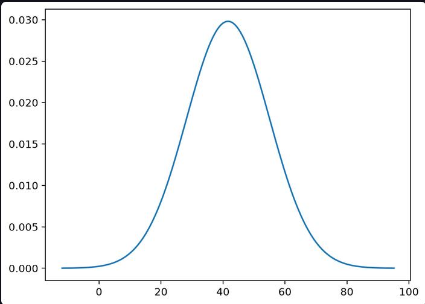

# Bank-marketing with Naive-Bayes

In this project I have applied Gussian Naive-Bayes from scratch in [Bank-marketing](https://www.kaggle.com/datasets/janiobachmann/bank-marketing-dataset/) dataset in kaggle. This markdonw is just the overview of project and how I made this. I have given more detail in my [notes](https://github.com/gitbhusalhubpramish/ml-notes/tree/main/0.007%20navie-bayes) about Naive-Bayes.

This is one of the probability distribution image of the algorithm. It is hard to visulize. Main thing here is the accuracy and tables rather than graph.

## Small intro to Naive-Bayes

Naive-Bayes is a Probability bashed supervised Meachine Learning algorithm. It uses Probabilities (Bayes theorem) to predict or classify any data. There are 2 types of Naive bayes - Categorical and Gussian. I have used both here. Categorial are used for catorigal data while gussian is used for numerical data.

